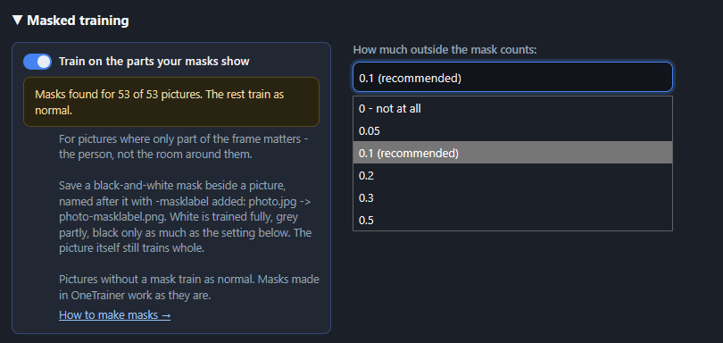
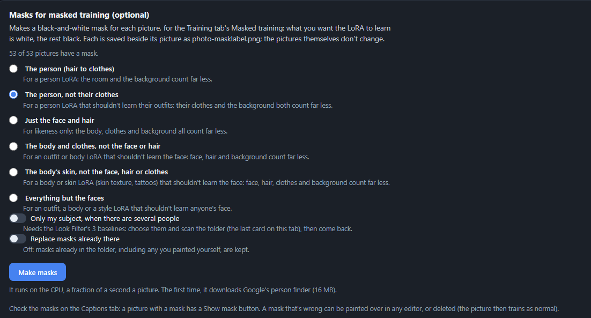

# Masked training

Train on the part of each picture that matters: the person, not the room around them. A black-and-white mask beside a picture says which part counts. White is trained fully, grey partly, and black only as much as you choose. The picture itself still trains whole, so the LoRA sees your subject in their scene; it just stops copying the scene.

It works for Klein, Krea 2, Qwen Image 2.1, Flux 3, MOSS-Image, Z-Image, SDXL and Anima (photos; not clips or songs).

In our tests of character LoRAs, masks significantly raised both the best likeness a run reached, by eye and in likeness scores, and how quickly it got there, on every recent model. It seems especially effective on MOSS-Image with its default Clean-end share, Slide.

## How do I…?

### …turn it on?

Training tab → **Masked training** card → tick **Train on the parts your masks show**. The line under it says how many pictures have a mask. Pictures without one train as normal.



Start won't run with it ticked and no masks in the training folder.

### …make masks automatically?

Image Prep tab → **Masks for masked training** card. Pick what the masks show:



- **The person (hair to clothes)**: for a person LoRA. The background counts far less.
- **The person, not their clothes**: a person LoRA that shouldn't learn their outfits. Clothes, accessories and background count far less.
- **Just the face and hair**: likeness only. Clothes, body and background count far less.
- **The body and clothes, not the face or hair**: an outfit or body LoRA that shouldn't learn the face. Face, hair and background count far less.
- **The body's skin, not the face, hair or clothes**: a body or skin LoRA (skin texture, tattoos) that shouldn't learn the face. Face, hair, clothes and background count far less.
- **Just the clothes**: for an outfit LoRA. Clothes and accessories train fully; the person wearing them and the background count far less.
- **Everything but the faces**: for an outfit, body or style LoRA that shouldn't learn anyone's face.
- **Just the background, not the people**: for a place or scene LoRA. The people in the pictures count far less; a picture with nobody in it trains whole.

Press **Make masks**. It runs on the CPU, a fraction of a second a picture. The first time, it downloads Google's person finder (MediaPipe Selfie Multiclass, 16 MB).

Masks already in the folder are kept unless you tick **Replace masks already there**, so a mask you painted yourself is safe.

Make masks after resizing and face crops. A crop made later carries its mask with it, but this way the masks you check are the final ones.

### …keep only my subject when there are other people in the picture?

Tick **Only my subject, when there are several people**. Fizgig finds your subject by their face, using the Look Filter's 3 baselines (the last card on the Image Prep tab: choose them and scan the folder first). The other people count as background.

### …make masks by hand, or use masks from OneTrainer?

Save a black-and-white picture beside each photo, named after it with `-masklabel` added:

```
beach.jpg
beach-masklabel.png
```

Paint white over what you want learned and black over the rest; grey for in between and soft edges. A mask smaller than its picture is fine (it's stretched to fit), as is one painted white on a transparent layer (transparent counts as black). OneTrainer uses the same naming, so its masks work as they are.

### …check a mask?

Captions tab: a picture with a mask has a **Show mask** button.

### …choose how much the background counts?

**How much outside the mask counts**, under the tick. 0.1 (recommended, and OneTrainer's default) keeps a little of the background, so the LoRA still knows your subject sits in a scene. 0 ignores it completely; then a very small mask trains hard on a few spots.

## What to watch out for

**A mask Fizgig won't use.** These are named under the tick and in the training log, and their pictures train without a mask:

- **All black.** It leaves nothing to train on.
- **Not its picture's shape.** The picture was cropped or rotated after the mask was made.

**Masks go with their pictures.** Remove on the Captions tab, Move Marked in the Look Filter, Image Prep's resize and face crops, Move a run and a training share all take a picture's mask along.

**Each picture counts the same.** A picture with a small mask isn't trained more weakly than one with a big mask: the loss is scaled so every picture's weight is the same as without masks. (OneTrainer calls this "normalize masked area loss"; here it's always on.)

**The saved LoRA says it was masked.** Its metadata carries `ss_masked_training`, `ss_mask_floor` and how many pictures had a mask.
